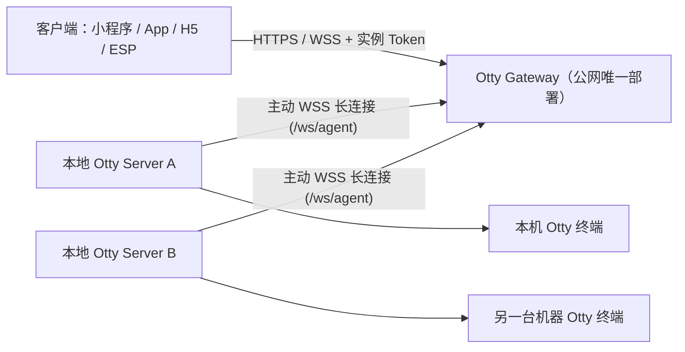

# Otty Server & Gateway

将本机 Otty 终端转为远程服务，支持 **Gateway 反向隧道模式**（无需给每台本地机器配公网 IP）和可选的**本地 HTTP 监听模式**。供小程序、App、H5、ESP 远程调用：列出 / 新开 / 关闭 Tab，读取 Tab 终端内容，向 Tab 发送消息或按键，等待 Tab 空闲，以及通过 WebSocket 订阅实时状态推送。

## 架构



1. **服务端只部署一个 `gateway.py`**：配置 `OTTY_GATEWAY_REGISTER_KEY`（注册密钥，防止他人注册实例）。
2. **每台电脑在 Otty 专用 Shell pane 中启动 `main.py`**：
   - 首次启动会自动生成持久化的**实例 ID**（`inst_…`）与**实例长 Token**（`otty_…`），保存在 `~/.config/otty-server/instance.json`（权限 `0600`），并打印在终端。
   - 主动通过 WebSocket 连接 Gateway，断线自动重连。
3. **客户端只连 Gateway**：携带该实例的 `Authorization: Bearer <实例Token>` 即可调用 HTTP 接口或连接客户端 WebSocket。

---

## 1. 部署公网 Gateway

在有公网 IP 的服务器上运行：

```bash
uv sync
export OTTY_GATEWAY_REGISTER_KEY="$(python3 -c 'import secrets;print(secrets.token_urlsafe(32))')"
export OTTY_GATEWAY_PORT=8080
uv run gateway.py
```

- 公网入口请配合 HTTPS / WSS 反向代理（如 Nginx / Caddy）。
- Gateway 内存中只保存实例 Token 的 SHA-256 摘要，不落盘明文 Token。

## 2. 启动本地 Otty Server

在 **Otty 本机的专用 Shell pane** 中运行（需在 Otty 设置中开启 `ipc-allow-send-keys`）：

```bash
export OTTY_GATEWAY_URL="https://你的gateway域名"
export OTTY_GATEWAY_REGISTER_KEY="与Gateway一致的注册密钥"
uv run main.py
```

启动后会打印本机凭证与调用地址：

```text
=== Otty Server ===
Instance ID : inst_8f3a1c9e2b10
Token       : otty_xxxxxxxxxxxxxxxxxxxxxxxxxxxxxxxxxxxxxxxxxxx
Credentials : /Users/you/.config/otty-server/instance.json (loaded, mode 0600)
Gateway WS  : wss://你的gateway域名/ws/agent
PWA Client  : https://你的gateway域名/#token=otty_xxxxxxxxxxxxxxxxxxxxxxxxxxxxxxxxxxxxxxxxxxx
Client HTTP : https://你的gateway域名/api/v1/tabs
            : https://你的gateway域名/i/inst_8f3a1c9e2b10/api/v1/tabs
===================
```

- 直接在手机浏览器打开上面打印的 `PWA Client` 链接，会自动保存 Token 并擦除地址栏后缀；随后在 Safari / Chrome 点 **「分享 → 添加到主屏幕」**，从桌面图标打开即可进入 **无顶底浏览器栏、防误触退回的 100% 全屏独立 App 模式**（模块位于 `client/pwa/`）。
- 如需同时开启本机 HTTP 端口方便局域网调试，加上 `--listen`（或设置 `OTTY_SERVER_LISTEN=1`）。
- 如不设置 `OTTY_GATEWAY_URL`，默认退化为纯本地 HTTP 监听（`http://127.0.0.1:8000`），同样直接内置了 PWA 界面。

| 环境变量 | 作用 |
| --- | --- |
| `OTTY_GATEWAY_URL` | Gateway 地址（`https://...` 或 `wss://...`） |
| `OTTY_GATEWAY_REGISTER_KEY` | Gateway 注册密钥（Gateway 与本地 Server 均需配置，至少 16 字符） |
| `OTTY_SERVER_TOKEN` | 可选；不设则自动生成并持久化到 `~/.config/otty-server/instance.json` |
| `OTTY_INSTANCE_ID` | 可选；自定义实例 ID（默认由 Token 派生 `inst_…`） |
| `OTTY_SERVER_LISTEN` | 设为 `1`（或传 `--listen`）时，连接 Gateway 的同时开启本地 HTTP 监听 |
| `OTTY_SERVER_ALLOW_SHELL_INPUT` | 设为 `1` 才允许向**普通 Shell Tab** 发消息 / 按键，默认关闭 |
| `OTTY_GATEWAY_CORS_ORIGINS` | Gateway 允许的 H5 跨域来源，多个用逗号分隔 |

---

## 3. 客户端调用方式

### 方式 A：HTTP 接口（适合小程序 / ESP / App / H5）

由于每个实例的 Token 唯一，客户端既可以直接请求 `/api/v1/...`（Gateway 自动按 Bearer Token 路由到对应实例），也可以显式带上实例路径 `/i/{instance_id}/api/v1/...`：

| 方法与路径 | 用途 |
| --- | --- |
| `GET /gateway/health` | 检查 Gateway 在线实例数 |
| `GET /api/v1/health` | 检查目标 Otty 宿主 pane 是否可用 |
| `GET /api/v1/tabs` | 列出所有 Tab：标题、目录、活动 pane、Agent 及状态 |
| `POST /api/v1/tabs` | 在指定目录新开 Tab，可选启动命令（如 `claude`、`codex`） |
| `GET /api/v1/tabs/{id}` | 查询单个 Tab |
| `DELETE /api/v1/tabs/{id}` | 关闭 Tab（连同其中程序） |
| `GET /api/v1/tabs/{id}/screen` | 分页读取终端文本，默认每页 50 行 |
| `POST /api/v1/tabs/{id}/messages` | 输入文本并提交 |
| `POST /api/v1/tabs/{id}/keys` | 按键，用于回答 Agent 的选择 / 批准菜单 |
| `GET /api/v1/tabs/{id}/wait` | 长轮询，直到 Tab 空闲或超时（默认 25 秒，最多 60） |

> 以上所有 `/api/v1/...` 路径均可加前缀 `/i/{instance_id}` 访问，例如 `GET /i/inst_xxx/api/v1/tabs`。

```bash
B="https://你的gateway域名/api/v1"
H="Authorization: Bearer $OTTY_SERVER_TOKEN"

# 1. 列出 Tab
curl -s "$B/tabs" -H "$H"

# 2. 发消息
curl -s "$B/tabs/t_xxx/messages" -H "$H" -H 'Content-Type: application/json' \
  -d '{"text":"看看这个项目，告诉我它的用途"}'

# 3. 读屏幕（默认最新 50 行，向上翻页传 ?before=nextBefore）
curl -s "$B/tabs/t_xxx/screen" -H "$H"
```

### 方式 B：客户端 WebSocket（实时推送 + 双向请求）

连接地址：
- `wss://你的gateway域名/ws/client?token=<实例Token>`
- 或 `wss://你的gateway域名/i/<instance_id>/ws?token=<实例Token>`（也支持 `Authorization: Bearer <实例Token>` 请求头）

连接成功后：
1. **自动收到连接状态与 Tab 实时变化推送**：
   ```json
   {"type": "connected", "instance_id": "inst_xxx", "online": true, "tabs": null}
   {"type": "event", "event": "tabs.updated", "instance_id": "inst_xxx", "tabs": [...]}
   ```
   当没有客户端订阅 WebSocket 时，本地 Server 不会轮询推送；一旦有客户端订阅，本地 Server 自动检测 Tab 状态变化并推送。
2. **也可以直接在 WebSocket 上发送请求**：
   ```json
   {"type": "request", "id": "1", "method": "POST", "path": "/api/v1/tabs/t_xxx/messages", "body": {"text": "你好"}}
   ```
   收到响应：
   ```json
   {"type": "response", "id": "1", "status": 200, "body": {"tab_id": "t_xxx", "pane_id": "p_xxx", "delivery": "queue", "receipt": {"queued": true, "pending": 1}}}
   ```

---

## 开发验证

```bash
uv run pytest
uv run ruff check .
```
